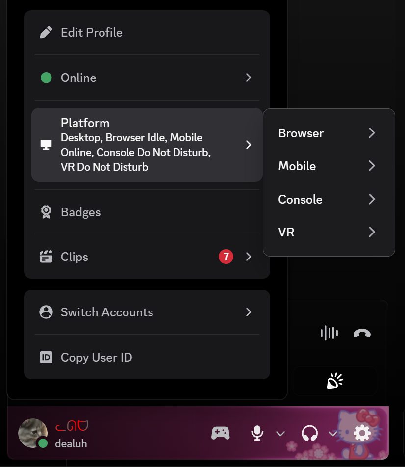
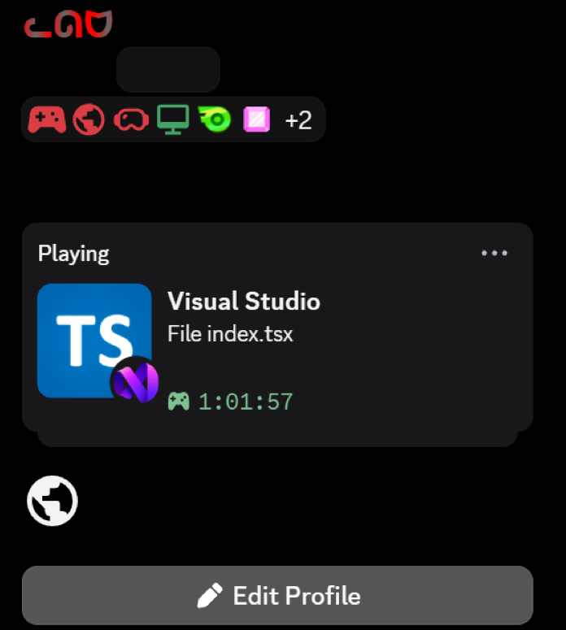

custom plugin i made to enable extra browser, mobile, console, and VR sessions next to your existing desktop icon. each one can have its own status like idle / dnd / online.

i was not successful replacing the existing desktop session, this plugin only adds extra visible sessions on top of your existing session.

browser isnt supported, and this was made for the desktop Vencord client.

obviously, this is only visible to people using platform indicators plugin, which is a lot of people, its also kind of obnoxious Xd

## how do i install this??

your vencord already inside discord cannot load this file on its own, it has to be injected!

1. download vencord source: https://github.com/Vendicated/Vencord
2. create this folder:

`Vencord/src/userplugins/platformplus.desktop`

3. in the Vencord folder, run:

```
pnpm install
pnpm build
pnpm inject
```

4. then restart your discord client.

this updates the Vencord you already have, it doesnt interfere with your existing vencord.

my plugin loads under your account popout whatever

if you want to use this or modify this for yourself, credit me, thanku c:



